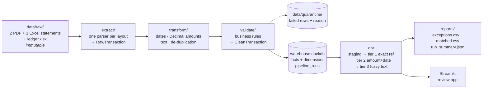

# ReconPipe

[](https://github.com/MUKIZA-The-Data-Engineer/Finance_system_project/actions/workflows/ci.yml)

**Reconciles 288 bank transactions across 3 bank statement formats in about 10 seconds,
auto-matches 96.5% of them, and turns the other 16 into a reviewable exception report.
Every item is classified correctly against ground truth (294/294).**

## The problem

At month end, a finance team checks every line on every bank statement against the
company's books. The statements arrive as PDFs and spreadsheets in a different layout
from each bank, and the books use different references, wording and dates, so the
check is done by hand, line by line. ReconPipe reads the statements as they are,
matches what it can with evidence, and hands a person only what genuinely needs a
person, each item pointing back to the exact file and row on both sides.


## Architecture

Each layer reads only from the layer below it, writes only to the layer above it, and
never edits anything in place. Every row carries its source file and row number, so
any number in a report can be walked back to the line it came from.



| Layer | Tool | Where |
|---|---|---|
| Extraction | pdfplumber, openpyxl | [`src/reconpipe/extract/`](src/reconpipe/extract/) |
| Transformation | Python, `Decimal` | [`src/reconpipe/transform/`](src/reconpipe/transform/) |
| Validation | Pydantic + business rules | [`src/reconpipe/schemas.py`](src/reconpipe/schemas.py), [`validate/`](src/reconpipe/validate/) |
| Warehouse | DuckDB (star schema) | [`src/reconpipe/load/schema.sql`](src/reconpipe/load/schema.sql) |
| Matching | dbt-duckdb | [`dbt/`](dbt/) |
| Orchestration | Dagster | [`orchestration/`](orchestration/) |
| Serving | Streamlit | [`app/dashboard.py`](app/dashboard.py) |
| Engineering | pytest, ruff, Docker, GitHub Actions | [`tests/`](tests/), [`.github/workflows/ci.yml`](.github/workflows/ci.yml) |

### The matching cascade

Each tier only sees what the tiers before it could not match, and a pairing is kept
only when it is the best candidate for both sides, so no line is ever used twice.

| Tier | Pairs a bank line with ledger lines when… | Matched |
|---|---|---|
| 1 · exact reference | the reference is identical; ledger lines sharing it are summed (one transfer, several invoices) | 219 |
| 2 · amount + date | same account and amount, at most 2 days apart | 53 |
| 3 · fuzzy | same account and amount, up to 14 days apart, and similar text: 0.5 × word overlap + 0.5 × same counterparty ≥ 0.4 | 6 |

Everything else gets one of four exception statuses, each with a plain-English reason:
`amount_mismatch` (same reference, different amount), `missing_in_ledger`,
`missing_in_bank` (for example an uncleared cheque) and `duplicate_suspected`
(a double posting in the books).


## Results

On the committed data (Q1 2026, three fictional banks, one company ledger):

| | |
|---|---|
| Statement lines read | 292 (110 + 96 + 85 printed, plus 1 planted 0.00 line) |
| Removed as a reprint at a page break | 1 |
| Quarantined, with the rule broken | 3 (zero amount, broken balance chain, date in the future) |
| Loaded and reconciled | 288 bank lines against 296 ledger lines |
| Auto-matched | **278 (96.5%)**: 219 exact, 53 amount + date, 6 fuzzy |
| Exceptions for review | 16: 6 amount mismatches, 4 missing in the books, 3 missing on the statement, 3 double postings |
| Accuracy against ground truth | **294 / 294 items** |
| Value auto-reconciled / in exception | RWF 318,125,150 / RWF 19,450,550 |

## Quickstart

Python 3.11+.

```bash
python -m venv .venv
source .venv/bin/activate            # Windows Git Bash: source .venv/Scripts/activate
pip install -e ".[dev]"
python -m reconpipe                  # parse → validate → load → dbt build → reports
streamlit run app/dashboard.py       # review the exceptions
```

Or, with nothing but Docker:

```bash
docker compose up                    # reconcile, then the app on http://localhost:8501
```

Other entry points:

```bash
pytest                                                           # 252 tests
dbt build --project-dir dbt --profiles-dir dbt                   # matching + data tests only
dagster dev                                                      # the DAG in the Dagster UI
dagster asset materialize -m orchestration.definitions --select "*"
python scripts/generate_statements.py                            # regenerate the test data
```

`python -m reconpipe` writes `reports/exceptions.csv` (the handoff to an accountant),
`reports/matched.csv`, `reports/run_summary.json` and `data/quarantine/quarantine_<run>.csv`.

## The toolkit: upload any file, get results

Beyond the three known layouts, the same engine works on **any** bank statement
or ledger, PDF, Excel or CSV, English or French, from a web page or one command:

```bash
streamlit run app/toolkit.py                                   # upload, then download the results
reconpipe process statement.pdf                                # clean Excel + Odoo import
reconpipe process inbox                                        # every file dropped in inbox/
reconpipe workflow --bank statement.pdf --books ledger.xlsx    # clean, Odoo-ready, reconciled
```

| Tool | Command | Output |
|---|---|---|
| PDF bank statement → Excel | `reconpipe pdf-to-excel` | clean rows, raw extracted rows, issues |
| Excel standardiser | `reconpipe standardize` | standard columns, signed `Decimal` amounts, ISO dates, issues |
| Reconciliation engine | `reconpipe reconcile` | matched, mismatched, missing both ways, duplicates, with tolerances |
| AI assistant / prompt library | `reconpipe ai` | Claude maps unknown columns and answers finance prompts about a file |
| Odoo preparation | `reconpipe odoo-export` | validated bank-statement-line or journal-entry import |

Run on the sample data, `reconpipe workflow` gives exactly the dbt engine's result
(278 of 288 matched, the same exceptions item by item). The user guide is
[docs/TOOLKIT.md](docs/TOOLKIT.md).

## Orchestration

Six Dagster assets, one per stage, calling the same functions as
`python -m reconpipe`, with asset checks so a bad run is a failed run rather than a
quiet one: only expected files skipped, quarantine rate under 5%, every validated row
loaded, match rate above 90%. A daily schedule runs at 06:00 Africa/Kigali.


## Test data

Real bank statements are confidential, so ReconPipe ships a seeded generator
([`scripts/generate_statements.py`](scripts/generate_statements.py)) that writes three
deliberately different layouts:

- **Bank A (PDF):** a ruled table, `DD/MM/YYYY` dates, debit and credit columns, and descriptions that wrap onto a second table line.
- **Bank B (PDF):** unruled columns, `15 Mar 2026` dates, one signed `RWF -1,250.00` amount column, brought/carried-forward lines, and one row reprinted across a page break.
- **Bank C (Excel):** junk rows above the header, `YYYY-MM-DD` dates, and Money Out / Money In columns.

It also writes a ledger with planted problems (amount typos, missing entries on both
sides, double postings, date shifts beyond the tier-2 window, one-to-many settlements)
and one data-quality defect per validation rule in the statements. The expected
outcome of every line is in `tests/expected_results.json`, and the tests check the
pipeline against it item by item. Output is byte-identical for a given seed.

## Project structure

```
src/reconpipe/
  schemas.py          RawTransaction, CleanTransaction, LedgerEntry: the contracts between layers
  extract/            base.py (parser interface), registry.py, one parser per layout, ledger.py
  transform/          standardize.py: dates, Decimal amounts, descriptions, de-duplication
  validate/           contracts.py (business rules), quarantine.py
  load/               schema.sql, warehouse.py (idempotent loader)
  report/             builder.py: exceptions.csv, matched.csv, run_summary.json
  pipeline.py         python -m reconpipe
  cli.py              reconpipe <command>: run, process, workflow and the five tools
  tools/              the toolkit: reader, columns, standardizer, pdf_to_excel, reconcile,
                      odoo, ai (+ prompts/), workflow
dbt/                  staging, intermediate and marts models, generic and singular tests
orchestration/        Dagster assets, checks, job and schedule
app/dashboard.py      Streamlit review app
app/toolkit.py        Streamlit upload app (process, reconcile, AI assistant)
config/odoo.toml      Odoo journal and account codes for the imports
templates/            empty Odoo import templates
inbox/                drop files here for `reconpipe process inbox` (not committed)
scripts/              synthetic statement and ledger generator
tests/                252 tests, incl. an end-to-end run against ground truth
docs/                 TOOLKIT.md (user guide), DESIGN_DECISIONS.md, PORTFOLIO.md, images
CHANGELOG.md          release notes
```

## Design decisions

The full reasoning is in [docs/DESIGN_DECISIONS.md](docs/DESIGN_DECISIONS.md). In short:

- **DuckDB, not Postgres; no Spark.** Kilobytes of analytical data: an in-process columnar engine runs everywhere with nothing to operate.
- **One parser per layout behind one interface.** The second PDF layout needed one new file; nothing else changed. Two parsers claiming one file is an error, never a guess.
- **Quarantine, never drop.** A failed row is kept with its rule, reason and source, and counted in the run summary.
- **`Decimal`, never float; ambiguous dates fail loudly.** A reconciliation is an equality test to the cent, and a swapped day and month breaks every match after it.
- **The duplicate key includes the running balance,** so two genuine identical purchases on one day are both kept.
- **Matching in SQL, strictest evidence first, and every match says how it was made** (tier, confidence, detail).

## Limitations

- **Synthetic data only.** The parsers are proven on generated statements, not on a real bank's PDFs. A real layout needs its own parser and fixture.
- **Equal amounts only.** Tiers 2 and 3 need the same amount on both sides. Bank fees netted out of a payment, partial payments and foreign-currency conversion are reported as exceptions, not matched.
- **One-to-many only.** One bank line can settle several ledger lines (by shared reference), but several bank lines settling one ledger line are not combined.
- **Thresholds tuned on synthetic text.** The tier-3 similarity threshold and date windows were chosen by measuring the generated data and may need re-tuning on real descriptions.
- **Duplicates are exact copies.** A double posting with a slightly different description or date is not flagged as a duplicate. It surfaces as missing on the statement instead.
- **Single currency and single writer.** Everything is RWF, and DuckDB allows one writer, so a load and the review app should not run at the same moment.

## Roadmap

Deliberately out of scope for v1.0, and the natural next steps:

- **A BI reporting layer** on top of `recon_results`.
- **Multi-tenant support and a login** for more than one company.
- **Near-real-time ingestion** of statements as they arrive, instead of a daily batch.
- **Many-to-one and fee-netted matching** in the dbt cascade (the toolkit already
  matches one line against a group of two or three, and takes an amount tolerance).
- **Scanned PDFs** (OCR); today a PDF must contain text.

## Other projects in this repository

The older general-ledger reporting engine (`adapters.py`, `etl_pipeline.py`,
`reports.py`, `run_pipeline.py`, documented in `system.md`) and the AI-assisted Excel
mapper (`ai_ingestion/`) are separate projects kept at the repository root. They are
not part of ReconPipe.

## Licence

MIT
