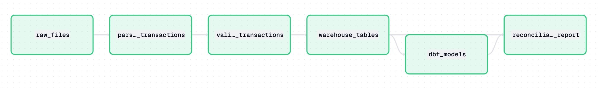
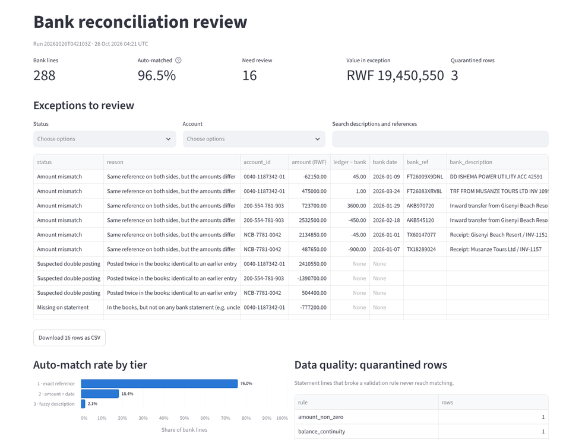
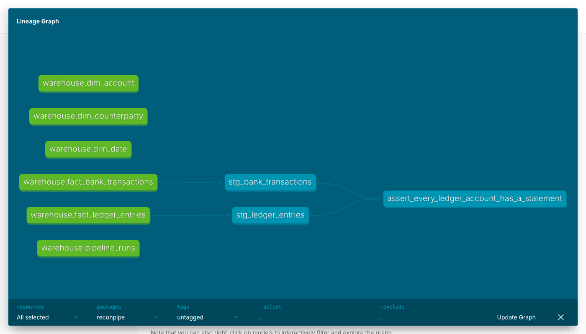

# ReconPipe

Bank statement → ledger reconciliation pipeline.

> Work in progress: day 13 of a 16-day build (26 Oct – 10 Nov 2026).
> The full README with the architecture, metrics and design decisions lands on day 15.

## Architecture

Each layer reads only from the layer below it, writes only to the layer above
it, and never edits anything in place.

```
data/raw/          original PDFs and Excel files, immutable
   |  extract/     one parser per bank layout, all emitting RawTransaction
   v
data/staging/      one row per transaction, still dirty, source file tracked
   |  transform/   dates, amounts, text normalisation, de-duplication
   |  validate/    CleanTransaction contract; failures go to data/quarantine/
   v
warehouse.duckdb   fact_transactions, dim_account, dim_counterparty
   |  dbt/         matching cascade: exact ref -> amount+date -> fuzzy description
   v
reports/           matched.csv, exceptions.csv, run_summary.json
```

The contract between layers lives in [`src/reconpipe/schemas.py`](src/reconpipe/schemas.py).

## Quickstart

```bash
python -m venv .venv
source .venv/bin/activate        # Windows Git Bash: source .venv/Scripts/activate
pip install -e ".[dev]"
python scripts/generate_statements.py   # writes data/raw/ + tests/expected_results.json
pytest
python -m reconpipe                     # everything: parse -> validate -> load -> dbt -> reports
```

`python -m reconpipe` prints the headline and writes `reports/exceptions.csv` (what a
person must look at, with the file and row on both sides), `reports/matched.csv` and
`reports/run_summary.json`. To run only the dbt part again:
`dbt build --project-dir dbt --profiles-dir dbt`.

## Orchestration

[`orchestration/`](orchestration/) runs the same pipeline as six Dagster assets with
asset checks (only expected files skipped, quarantine rate, every validated row
loaded, match rate above 90%) and a daily 06:00 schedule (Africa/Kigali).

```bash
dagster dev                                                     # UI on http://localhost:3000
dagster asset materialize -m orchestration.definitions --select "*"   # one command, whole DAG
```



## Review app

```bash
streamlit run app/dashboard.py        # after python -m reconpipe
```

Four things, read straight from DuckDB: the run's headline numbers, a filterable
exceptions table that downloads as CSV (the handoff to an accountant), the match
rate by tier, and the rows quarantined for data quality.



## Result

> Reconciles 288 bank transactions across 3 bank formats in about 9 s, auto-matching
> 96.5%, and surfaces the other 16 items as a reviewable exception report.

Checked against the generator's ground truth, every item is classified correctly
(294/294): 219 exact-reference matches, 53 amount + date, 6 fuzzy, and the 16 planted
exceptions (6 amount mismatches, 4 missing in the books, 3 missing on the statement,
3 double postings). 3 malformed statement lines are quarantined before matching.

Then ask the warehouse a question, for example total debits per account per month:

```sql
SELECT account_id, strftime(date_key, '%Y-%m') AS month,
       sum(-amount) FILTER (WHERE amount < 0) AS total_debits
FROM fact_bank_transactions
GROUP BY ALL ORDER BY ALL;
```

From Python (or any DuckDB client):

```bash
python -c "import duckdb; print(duckdb.connect('warehouse.duckdb').sql('SELECT * FROM pipeline_runs'))"
```

## Warehouse

Star schema in DuckDB ([`src/reconpipe/load/schema.sql`](src/reconpipe/load/schema.sql)).
**Grain: one row per bank statement transaction per source file**, and one row per
ledger journal line. Bank and ledger stay in separate fact tables until matching.

| Table | Holds |
|---|---|
| `fact_bank_transactions` | validated statement rows (quarantined rows never arrive) |
| `fact_ledger_entries` | the company ledger |
| `dim_account`, `dim_counterparty`, `dim_date` | accounts, counterparty names, calendar |
| `pipeline_runs` | one row per run: counts and duration |

## dbt

[`dbt/`](dbt/) builds on the warehouse: staging views (`stg_bank_transactions`,
`stg_ledger_entries`) do renaming and casting only, and `schema.yml` tests them with
`unique`, `not_null`, `accepted_values`, `relationships`, a custom generic test
(`not_zero`) and a singular test (every ledger account has a statement).



### The matching cascade

Each tier only sees what the tiers before it could not match, and a ledger line
is never used twice.

| Tier | Model | Pairs a bank line with ledger lines when… |
|---|---|---|
| 1 | `recon_tier1_exact` | the reference is identical; several ledger lines sharing it are summed (one-to-many). Same reference, different total → `amount_mismatch` |
| 2 | `recon_tier2_amount_date` | same account and amount, at most 2 days apart, and each is the other's closest candidate |
| 3 | `recon_tier3_fuzzy` | same account and amount, up to 14 days apart, and similarity ≥ 0.4, where similarity = 0.5 × word overlap + 0.5 × same counterparty |

Before matching, `int_ledger_entries` flags exact double postings (the later copy is the
duplicate). `recon_results` then gives every item one status: `matched`,
`amount_mismatch`, `missing_in_ledger`, `missing_in_bank` or `duplicate_suspected`,
with the match tier, a confidence and the source file and row on both sides.
Thresholds live in `dbt/dbt_project.yml` under `vars`.

Loading is idempotent: each run replaces the rows of the files it loaded, in one
transaction, so re-running never double-loads and a failed load rolls back.

The bank statements are confidential, so ReconPipe ships a seeded generator: three
deliberately different bank layouts (two PDF, one Excel), a ledger with planted
discrepancies, and the ground truth in `tests/expected_results.json`. Your own
real files belong in `data/real/`, which the pipeline never reads.

## Repository layout

| Path | Purpose |
|---|---|
| `src/reconpipe/` | The pipeline package: `extract/`, `transform/`, `validate/`, `load/`, `report/` |
| `scripts/` | Synthetic bank statement and ledger generator |
| `dbt/` | Staging models and the reconciliation matching cascade |
| `orchestration/` | Dagster assets and schedule |
| `app/` | Streamlit review app |
| `tests/` | pytest suite |

The older general-ledger reporting engine (`adapters.py`, `etl_pipeline.py`,
`reports.py`, `run_pipeline.py`, see `system.md`) and the AI-assisted Excel
mapper (`ai_ingestion/`) are separate projects kept at the repository root.
They are not part of ReconPipe.

## Licence

MIT
