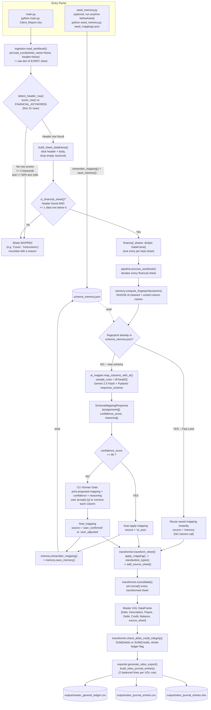

# Architecture — Confidence-Driven Finance ETL Pipeline

This document covers the `ai_ingestion/` pipeline: the AI-assisted,
schema-agnostic module that turns an unpredictable multi-sheet Excel
export into an Odoo-ready Universal General Ledger (UGL). It does not
cover the separate CoA-based reporting engine at the repository root
(`adapters.py` / `etl_pipeline.py` / `reports.py`) — see `system.md` for
that one.

---

## 1. System Architectural Flowchart



### Reading the diagram

- **Two entry points, one shared file.** `seed_memory.py` and `main.py`
  never call each other — they only communicate through
  `schema_memory.json` on disk. Seeding is a one-time, offline step; `main.py`
  is what you run against a real workbook. If a sheet's fingerprint was
  seeded ahead of time, `main.py`'s very first encounter with that format
  is already a Fast Lane hit.
- **Every sheet independently walks the whole right-hand path.** A single
  workbook with 5 sheets can produce 5 different outcomes: some skipped,
  some Fast Lane, some auto-applied, some needing a human — `pipeline.py`
  makes this decision per sheet, not per workbook.
- **`schema_memory.json` is both read and written by the same run.** A
  sheet resolved via AI or a human this run is saved immediately (not
  batched to the end), so an interrupted CLI session doesn't lose already-
  approved mappings.

---

## 2. File-by-File Responsibility Guide

### `main.py`
- **Responsibility:** CLI entry point; wires all six stages together for one workbook end-to-end.
- **Inputs:** `file_path` (positional CLI arg — path to `.xlsx`); `--output-dir` (default `./output`); `--memory-path` (default `./schema_memory.json`).
- **Outputs:** Console progress log for every stage; writes `output/master_general_ledger.csv`, `output/odoo_journal_entries.csv`, `output/odoo_journal_entries.xlsx`; process exit code (`0` success, `1` on a hard error like a missing file or zero financial sheets found).
- **Imports/calls:** `ingestion.discover_financial_sheets`, `pipeline.process_workbook`, `transformer.consolidate`, `transformer.check_debit_credit_integrity`, `exporter.generate_odoo_export`, `memory.DEFAULT_MEMORY_PATH`.

### `seed_memory.py`
- **Responsibility:** Bulk-preload `schema_memory.json` with mappings authored ahead of time — bypasses ingestion/AI/CLI entirely so a known, recurring format hits the Fast Lane on its very first real run through `main.py`.
- **Inputs:** `seed_file` (positional CLI arg — path to a JSON list of `{raw_columns, mapping, confidence_score, reasoning}` entries, see `sample_data/seed_mappings.example.json`); `--memory-path`.
- **Outputs:** Writes/updates `schema_memory.json`; prints one line per seeded entry plus a summary count.
- **Imports/calls:** `memory.compute_fingerprint`, `memory.load_memory`, `memory.remember_mapping`, `memory.save_memory`. Deliberately does **not** import `ingestion`, `ai_mapper`, `pipeline`, or `transformer` — its only relationship to the rest of the system is the shared `schema_memory.json` file.

### `ingestion.py`
- **Responsibility:** Stage 1 — read every sheet in the workbook, locate each sheet's true header row (ignoring title blocks/logos above it), and filter down to only genuinely financial sheets.
- **Inputs:** `file_path` (path to `.xlsx`).
- **Outputs:** `discover_financial_sheets()` → `(financial_sheets: dict[str, DataFrame], skipped_sheets: dict[str, str])` — the second dict maps skipped sheet names to a human-readable reason.
- **Imports/calls:** `pandas` only. This is the foundational layer — it imports nothing else from this project.

### `memory.py`
- **Responsibility:** Stage 2 — schema fingerprinting and the JSON-backed mapping cache. Has zero awareness of Excel, AI, or the CLI; purely a hash + persistence utility.
- **Inputs:** column name lists, mapping dicts, confidence/reasoning strings, a `memory` dict, a file path.
- **Outputs:** `compute_fingerprint()` → `str` (SHA256 hex digest); `load_memory()` / `save_memory()` → `dict` / disk read-write side effect; `get_mapping_for_fingerprint()` → `dict | None`; `remember_mapping()` → mutated `dict`.
- **Imports/calls:** `hashlib`, `json`, `pathlib`, `datetime` only. Called **by** `pipeline.py` and `seed_memory.py`; calls nothing else in the project.

### `ai_mapper.py`
- **Responsibility:** Stage 3 — the AI Confidence Engine. For a schema `memory.py` has never seen, asks Gemini to propose a column mapping plus a self-reported confidence score, using a Pydantic structured-output schema so the response is always machine-parseable.
- **Inputs:** `raw_columns: list[str]`, `sample_rows: list[dict]` (typically `df.head(3)` as records), optional `model` override (default `gemini-2.5-flash`).
- **Outputs:** `map_columns_with_ai()` → `{"mapping": dict[str, str], "confidence_score": int, "reasoning": str}`. Raises `AIMapperError` if the package/API key is missing or the response can't be parsed.
- **Imports/calls:** `google.genai` (imported lazily, inside the function, so the module can still be imported without the package installed), `pydantic`, `python-dotenv`. Called **by** `pipeline.py`; imports nothing else in the project.

### `pipeline.py`
- **Responsibility:** Stage 4 — the routing / exception gate. Decides Fast Lane vs. AI vs. Human Gate for each sheet, and persists every newly-approved mapping.
- **Inputs:** `financial_sheets: dict[str, DataFrame]` (from `ingestion.py`), `memory_path`.
- **Outputs:** `process_workbook()` → `dict[sheet_name, {"mapping", "confidence_score", "source", "fingerprint"}]`. Side effect: incrementally updates `schema_memory.json` after each newly-resolved sheet.
- **Imports/calls:** `memory.py` (`compute_fingerprint`, `get_mapping_for_fingerprint`, `remember_mapping`, `save_memory`, `load_memory`), `ai_mapper.py` (`map_columns_with_ai`, `TARGET_COLUMNS`). Called **by** `main.py`.

### `transformer.py`
- **Responsibility:** Stage 5 — apply each sheet's approved mapping, enforce the UGL's strict data types, tag `source_sheet`, consolidate every sheet into one master ledger, and run the whole-ledger Debit/Credit integrity check.
- **Inputs:** `df` + `mapping` + `sheet_name` (per-sheet functions); `financial_sheets` + `mappings` dicts (`consolidate()`); `master_df` (`check_debit_credit_integrity()`).
- **Outputs:** `transform_sheet()` → `DataFrame[Date, Description, Payee, Debit, Credit, Balance, source_sheet]`; `consolidate()` → the master `DataFrame` (all sheets concatenated); `check_debit_credit_integrity()` → `{"total_debit", "total_credit", "difference", "is_balanced"}`.
- **Imports/calls:** `pandas` only. Called **by** `main.py`; has no awareness of `memory`/`ai_mapper`/`pipeline` at all — it only ever sees a mapping dict it's handed.

### `exporter.py`
- **Responsibility:** Stage 6 — format the master UGL into Odoo `account.move`-ready Journal Entry lines (two balanced lines per source row: the real account + a suspense/clearing account pending manual reclassification in Odoo) and write both a CSV and an Excel copy.
- **Inputs:** `master_df` (the consolidated UGL DataFrame), `output_dir`.
- **Outputs:** `build_odoo_journal_entries()` → `DataFrame[id, date, journal_id, account_id, partner, label, debit, credit]`; `generate_odoo_export()` → `{"csv": Path, "xlsx": Path}` (side effect: files written to disk).
- **Imports/calls:** `pandas`, `pathlib` only. Called **by** `main.py`; no awareness of `memory`/`ai_mapper`/`ingestion`.

### Import dependency summary

```
main.py            -> ingestion, pipeline, transformer, exporter, memory (for the default path constant)
seed_memory.py      -> memory                                            (nothing else)
pipeline.py         -> memory, ai_mapper
transformer.py      -> (pandas only)
exporter.py         -> (pandas only)
ingestion.py        -> (pandas only)
memory.py           -> (stdlib only)
ai_mapper.py        -> google-genai, pydantic, python-dotenv             (nothing else in this project)
```

Notice the dependency graph is a strict DAG with no cycles, and the three
"pure" modules (`ingestion`, `transformer`, `exporter`) never import each
other or `memory`/`ai_mapper` — every cross-module decision is made by
`pipeline.py` and handed down as plain data (a `mapping` dict), which is
what makes each stage independently testable (see how the earlier build
verified `transformer`/`exporter` using a hand-written fake mapping,
with no Gemini call involved at all).

---

## 3. Data Flow Example: `Client_Report.xlsx`

Assume a workbook with three sheets:

| Sheet | Shape |
|---|---|
| `Cover` | Row 0: `"CLIENT REPORT"`, row 1: `"Prepared for internal review"` — no tabular data at all |
| `Transactions` | Rows 0-1: title block (`"CLIENT REPORT - MAIN OPERATING ACCOUNT"`, `"Period: Q1 2026"`), row 2: header, rows 3+: data — a schema **never seen before** |
| `Q1_Summary` | Header directly on row 0 — columns `["Trans Date","Details","Debit Amount","Credit Amount","Running Balance"]`, which happens to be **exactly** the schema pre-loaded via `seed_memory.py sample_data/seed_mappings.example.json` |

### Step 1 — `ingestion.py`

`read_workbook("Client_Report.xlsx")` returns:

```python
{
  "Cover":        <headerless DataFrame, 2 rows>,
  "Transactions": <headerless DataFrame, title block + header + data>,
  "Q1_Summary":   <headerless DataFrame, header on row 0 + data>,
}
```

- **`Cover`**: `detect_header_row()` scans both rows, finds no row hitting ≥2 financial keywords → `header_row_idx = None` → `skipped_sheets["Cover"] = "No header row with >= 2 financial keywords found in the first 15 rows"`.
- **`Transactions`**: row 2 (`["Txn Date","Memo","Amount Out","Amount In","Acct Balance"]`) scores 4 distinct keywords (`date`, `amount` ×2, `balance`) with a string ratio of 1.0 → detected as the header. `build_sheet_dataframe()` slices rows 3+ as the body.
- **`Q1_Summary`**: row 0 is the header directly; same detection logic applies.

Result:

```python
financial_sheets = {
    "Transactions": DataFrame[["Txn Date","Memo","Amount Out","Amount In","Acct Balance"], 5 rows],
    "Q1_Summary":   DataFrame[["Trans Date","Details","Debit Amount","Credit Amount","Running Balance"], 4 rows],
}
skipped_sheets = {"Cover": "No header row with >= 2 financial keywords found in the first 15 rows"}
```

### Step 2 — `memory.py` (via `pipeline.process_workbook`)

```python
fingerprint("Transactions")  # columns: txn date|memo|amount out|amount in|acct balance
# -> "7fa2c9..."  -- NOT in schema_memory.json (never seen)

fingerprint("Q1_Summary")    # columns: trans date|details|debit amount|credit amount|running balance
# -> "590512394f21..." -- ALREADY in schema_memory.json (seeded earlier)
```

`Q1_Summary` resolves immediately:

```python
{"mapping": {"Trans Date": "Date", "Details": "Description", "Debit Amount": "Debit",
             "Credit Amount": "Credit", "Running Balance": "Balance"},
 "confidence_score": 100, "source": "memory", "fingerprint": "590512394f21..."}
```

No Gemini call happens for this sheet at all.

### Step 3 — `ai_mapper.py` (only for `Transactions`)

`sample_rows = df.head(3).to_dict(orient="records")`:

```python
[
  {"Txn Date": "2026-01-05", "Memo": "Client Retainer - Acme", "Amount Out": None,   "Amount In": 5000.0, "Acct Balance": 5000.0},
  {"Txn Date": "2026-01-09", "Memo": "Office Lease - Jan",     "Amount Out": 1200.0, "Amount In": None,   "Acct Balance": 3800.0},
  {"Txn Date": "2026-01-14", "Memo": "Consulting Fee - Globex","Amount Out": None,   "Amount In": 2500.0, "Acct Balance": 6300.0},
]
```

Gemini's structured response (`SchemaMappingResponse`, parsed via `response.parsed`):

```python
assignments = [
    {"raw_column": "Txn Date",     "target_column": "Date"},
    {"raw_column": "Memo",         "target_column": "Description"},
    {"raw_column": "Amount Out",   "target_column": "Debit"},
    {"raw_column": "Amount In",    "target_column": "Credit"},
    {"raw_column": "Acct Balance", "target_column": "Balance"},
]
confidence_score = 92
reasoning = "Column names clearly correspond to a transaction ledger with separate debit/credit amounts and a running balance."
```

`map_columns_with_ai()` converts this into:

```python
{"mapping": {"Txn Date": "Date", "Memo": "Description", "Amount Out": "Debit",
             "Amount In": "Credit", "Acct Balance": "Balance"},
 "confidence_score": 92, "reasoning": "..."}
```

### Step 4 — `pipeline.py` gate

- `Transactions`: `confidence_score = 92 >= 90` → **AUTO-APPLY**, `source = "ai_auto"`. `memory.remember_mapping()` + `save_memory()` write this brand-new fingerprint into `schema_memory.json` — next quarter's `Transactions` sheet (identical columns) will hit the Fast Lane instead of calling Gemini again.
- `Q1_Summary`: already resolved in Step 2, `source = "memory"`.

No human prompt occurs in this example (both sheets cleared the gate one way or another) — if `Transactions` had scored, say, 75, the CLI would have shown the proposed mapping and paused for `y`/corrections before continuing.

### Step 5 — `transformer.py`

`transform_sheet(df, mapping, "Transactions")`:

1. `apply_mapping()` selects/renames the 5 raw columns → `[Date, Description, Payee, Debit, Credit, Balance]` (Payee is added as all-`NaN` — nothing in this sheet's mapping targets it).
2. `standardize_types()` — `"2026-01-05"` → ISO `"2026-01-05"`; `Amount Out`/`Amount In`/`Acct Balance` → floats, blanks → `0.0`; `Description` stripped, filled `""`.
3. `add_source_sheet()` stamps `source_sheet = "Transactions"` on every row.

Same for `Q1_Summary` → `source_sheet = "Q1_Summary"`.

`consolidate()` concatenates both into the master ledger (9 rows total: 5 + 4):

| Date | Description | Payee | Debit | Credit | Balance | source_sheet |
|---|---|---|---|---|---|---|
| 2026-01-05 | Client Retainer - Acme | | 0.0 | 5000.0 | 5000.0 | Transactions |
| 2026-01-09 | Office Lease - Jan | | 1200.0 | 0.0 | 3800.0 | Transactions |
| ... | ... | | ... | ... | ... | ... |
| 2026-01-03 | ... | | ... | ... | ... | Q1_Summary |

`check_debit_credit_integrity(master_df)` sums `Debit`/`Credit` across **both** sheets together and returns e.g. `{"total_debit": 6820.0, "total_credit": 9500.0, "difference": -2680.0, "is_balanced": False}` — printed as an `[ALERT]` for review (expected here, since these are individual statement lines, not matched double-entry pairs).

### Step 6 — `exporter.py`

`build_odoo_journal_entries(master_df)` emits **two lines per master row** (18 lines total for 9 rows), sharing external IDs `ugl_import_0` … `ugl_import_8`:

```
id,date,journal_id,account_id,partner,label,debit,credit
ugl_import_0,2026-01-05,BANK1,1000,,Client Retainer - Acme,0.0,5000.0
ugl_import_0,2026-01-05,BANK1,499999,,Client Retainer - Acme,5000.0,0.0
ugl_import_1,2026-01-09,BANK1,1000,,Office Lease - Jan,1200.0,0.0
ugl_import_1,2026-01-09,BANK1,499999,,Office Lease - Jan,0.0,1200.0
...
```

`generate_odoo_export()` writes `output/odoo_journal_entries.csv` and `.xlsx`; `main.py` additionally writes the pre-Odoo-formatting master ledger to `output/master_general_ledger.csv` for audit/reference. The final console summary reports both file paths and the `is_balanced` flag from Step 5.
