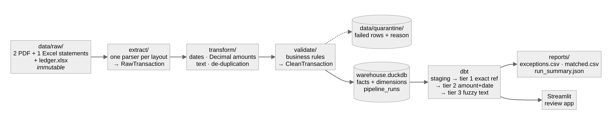

# ReconPipe: turning month-end bank reconciliation into a 10-second job

## The problem

Every month, the finance team I work with sat down with the bank statements and the
books and ticked lines off one by one. Three banks, three statement layouts: two
PDFs that look nothing alike and an Excel export with a different column order again.
The books describe the same money in different words ("POS 2743 SIMBA SUPERMARKET
KIGALI RW" on the statement is "Payment - Simba Supermarket - office supplies" in the
ledger), on different dates, often without the bank's reference. Most lines match
trivially; a handful don't, and those are the ones that matter: a mistyped amount, a
payment posted twice, a cheque that never cleared. Finding the handful meant reading
all of it.

## What I built

ReconPipe reads the statements as they arrive, matches what it can with evidence, and
gives a person only the items that genuinely need a person, each pointing back to the
exact file and row on both sides.

- **Extraction.** One parser per bank layout, all behind the same interface. The
  first PDF is a ruled table, the second has no ruling at all, so it is rebuilt from
  word positions. Adding the second layout took one new file and no change anywhere
  else, which was the point of the design.
- **Cleaning and validation.** Dates, `Decimal` money, normalised text, and
  de-duplication that keeps two genuine identical purchases while dropping a line the
  bank reprinted at a page break. Rows that break a rule are quarantined with their
  reason, never silently dropped.
- **Warehouse.** A small DuckDB star schema. Loading is idempotent: re-running never
  double-counts, and a failed load rolls back.
- **Matching.** A cascade in dbt: exact reference first (summing several ledger lines
  that one bank transfer settles), then amount and date, then amount plus text
  similarity. Every match records how it was made and how confident it is.
- **Delivery.** An exception report an accountant can work from, a Streamlit review
  app, a Dagster DAG with checks that fail a bad run loudly, Docker, and CI.

## The numbers

On a quarter of statements (288 bank lines against 296 ledger lines):

- **96.5% matched automatically**: 219 by exact reference, 53 by amount and date,
  6 by fuzzy text.
- **16 exceptions surfaced for review**, each with a plain-English reason: 6 amount
  mismatches, 4 lines missing from the books, 3 missing from the statements, and
  3 double postings.
- **3 malformed statement lines caught before matching**, one for each validation rule.
- **294 of 294 items classified correctly** against ground truth, in about 10 seconds.

Real statements are confidential, so the project ships a seeded generator that writes
realistic, messy statements and a ledger with planted problems, plus the expected
outcome of every line. That turns "it looks right" into a measured accuracy, checked
item by item in CI.

## Decisions I would defend in an interview

- **DuckDB, not Postgres, and no Spark.** This is kilobytes of analytical data. The
  right tool runs in-process and needs nothing to operate.
- **The adapter pattern for parsers.** The proof was the second layout: one new file,
  zero changes elsewhere. Two parsers claiming the same file is an error, never a
  guess.
- **Quarantine instead of dropping.** A dropped row is an invisible error in a
  financial report; a quarantined row is a to-do with an address.
- **Strictest evidence first, and every match explains itself.** A weak rule never
  steals a line a strong rule would have matched, and every match carries its tier,
  confidence and reason.

The full list is in [DESIGN_DECISIONS.md](DESIGN_DECISIONS.md).

## What I would do next

Read ledger exports straight from the accounting system (Odoo), handle fee-netted and
partial payments as extra matching tiers, prove the parsers on real statements, and
move the dbt models to a shared warehouse if more than one company uses it.

**Code:** [github.com/MUKIZA-The-Data-Engineer/Finance_system_project](https://github.com/MUKIZA-The-Data-Engineer/Finance_system_project)
