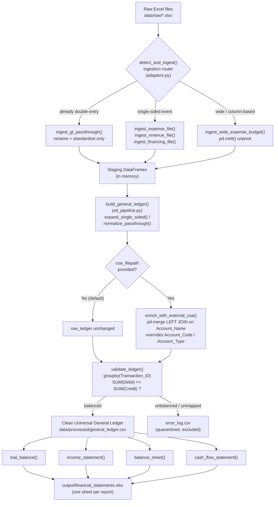
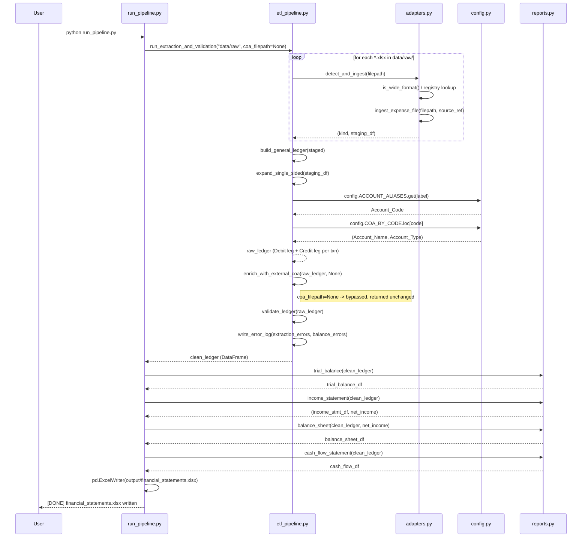
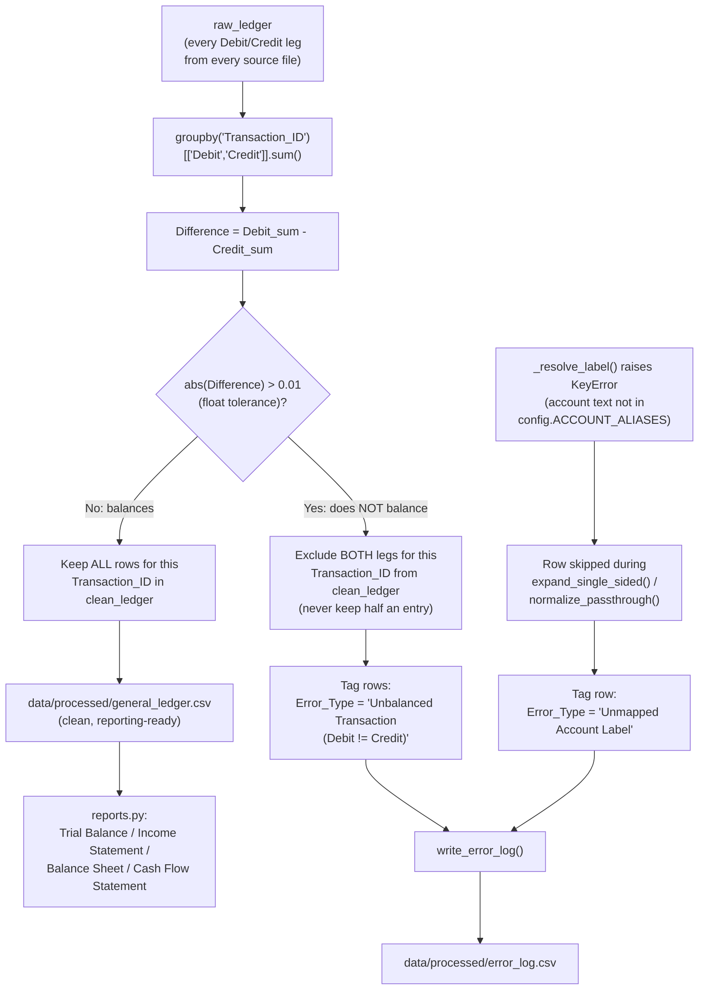

# System Architecture — Finance ETL Reporting Pipeline

## 1. Executive System Overview

### 1.1 Design Philosophy: One Ledger, Not Four Reports

The central architectural decision in this system is that **there is exactly
one authoritative data structure**: the Universal General Ledger (GL). Every
financial statement — Trial Balance, Income Statement, Balance Sheet, Cash
Flow Statement — is a **read-only view** computed from that one ledger via
`pandas` `groupby()` / `merge()` / filtering. Nothing is pre-aggregated into
report-specific tables, and no report holds state of its own.

This mirrors how a real double-entry accounting engine (Odoo, QuickBooks,
NetSuite) works internally: `account.move.line` (Odoo's GL table) is the
single source of truth, and every report — the P&L, the Balance Sheet, the
Aged Receivables — is a query against it, not a separately maintained table.

```
   FRAGMENTED DESIGN (rejected)          UNIVERSAL LEDGER DESIGN (this system)
   ─────────────────────────             ──────────────────────────────────
   expenses_table                                    ┌───────────────┐
   revenue_table          ──> 4 reports               │  General      │
   balances_table                                     │  Ledger       │──> groupby/merge ──> 4 reports
   cashflow_table                                     │  (1 table)    │
   (drift risk: each                                  └───────────────┘
    report can disagree)                    (single source of truth,
                                              reports can never disagree)
```

Why this matters in practice: fix a miscategorized transaction once in the
ledger, and the Trial Balance, Income Statement, Balance Sheet, and Cash Flow
Statement are all correct on the very next run — there is no second table to
remember to update.

### 1.2 Core Capabilities

| Capability | Where it lives | Summary |
|---|---|---|
| Multi-layout Excel ingestion | `adapters.py` | Detects and ingests 3 structurally different file shapes: already-double-entry ("pass-through"), single-sided (needs an invented offset leg), and wide/column-based (needs `pd.melt()`). |
| Double-entry engine | `etl_pipeline.py` | Explodes single-sided business events into balanced Debit/Credit leg pairs sharing one `Transaction_ID`. |
| Extensible Chart of Accounts | `config.py` + `data/chart_of_accounts.csv` | CoA is **data, not code** — accounts/aliases can be added by editing a CSV or calling `config.add_account()`, with zero pipeline code changes. |
| Optional external CoA enrichment | `etl_pipeline.enrich_with_external_coa()` | Optionally reconciles the ledger's account codes against an authoritative external CoA export (e.g. from a live Odoo instance) via a `pd.merge` left join. Fully bypassable (`coa_filepath=None`). |
| Automated double-entry validation | `etl_pipeline.validate_ledger()` | Enforces Σ Debit == Σ Credit per `Transaction_ID`; anything that fails is quarantined to `error_log.csv`, never silently included in a report. |
| Automated report generation | `reports.py` | Trial Balance, Income Statement, Balance Sheet (with dynamically injected Retained Earnings), and a GL-derived Cash Flow Statement — all pure functions over the clean ledger. |
| Excel workbook output | `run_pipeline.py` | Writes one `.xlsx` with one sheet per report, plus the ledger itself, via `pandas.ExcelWriter`. |

---

## 2. Directory & File Architecture

### 2.1 Repository Tree

```
finance_system/
├── config.py                        # Chart of Accounts loader + accounting constants
├── adapters.py                      # Phase 1 — extraction & shape adapters
├── etl_pipeline.py                  # Phase 2 — double-entry engine, CoA enrichment, validation
├── reports.py                       # Phase 3 — Trial Balance / P&L / Balance Sheet / Cash Flow
├── generate_sample_data.py          # Fixture generator — messy demo Excel files
├── run_pipeline.py                  # Orchestrator / sample script — the file you actually run
├── requirements.txt                 # pandas + openpyxl
├── HOW-TO_RUN.md                    # Setup & operation guide
├── system.md                        # This file
│
├── data/
│   ├── chart_of_accounts.csv        # INTERNAL, editable Chart of Accounts (source of truth)
│   ├── odoo_coa_sample.csv          # Sample EXTERNAL CoA export, for the optional enrichment demo
│   ├── raw/                         # Landing zone — raw, messy input Excel files (input)
│   │   ├── bank_ledger_export.xlsx          (already double-entry / pass-through)
│   │   ├── expenses_july.xlsx               (single-sided expense log)
│   │   ├── sales_invoices_july.xlsx         (single-sided revenue log)
│   │   ├── financing_activities.xlsx        (single-sided financing log)
│   │   └── monthly_expense_budget_wide.xlsx (wide/column-based, needs pd.melt)
│   └── processed/                   # Pipeline output (generated, not hand-edited)
│       ├── general_ledger.csv               (clean Universal GL)
│       └── error_log.csv                    (quarantined rows — see §3.3 / §4.3)
│
└── output/
    └── financial_statements.xlsx    # Final deliverable: one workbook, one sheet per report
```

### 2.2 File-by-File Reference

#### `config.py` — Chart of Accounts & Accounting Constants

| | |
|---|---|
| **Purpose** | Single source of truth for account metadata. Loads the CoA from CSV (not hard-coded) so bookkeepers can add accounts without touching code. |
| **Key symbols** | `CHART_OF_ACCOUNTS` (DataFrame), `COA_BY_CODE` (indexed lookup), `ACCOUNT_ALIASES` (flattened `{alias: code}` dict), `CF_CATEGORY_MAP` (`{code: cash-flow bucket}`), `NORMAL_BALANCE` (`{account_type: "Debit"\|"Credit"}`), `CASH_CODE` / `AR_CODE` / `AP_CODE` / `RETAINED_EARNINGS_CODE` |
| **Key functions** | `reload()` — re-derives all the above from the CSV; `add_account(code, name, account_type, aliases=[])` — appends a row to the CSV and calls `reload()` |
| **Reads** | `data/chart_of_accounts.csv` |
| **Writes** | `data/chart_of_accounts.csv` (only when `add_account()` is called) |
| **Consumed by** | `etl_pipeline.py` (account resolution), `reports.py` (normal-balance sign logic, CF categorization) |

> **Mutability note:** `CHART_OF_ACCOUNTS`, `COA_BY_CODE`, `ACCOUNT_ALIASES`,
> and `CF_CATEGORY_MAP` are rebound (not mutated in place) every time
> `reload()`/`add_account()` runs. Downstream modules therefore access them
> as `config.ACCOUNT_ALIASES` (qualified attribute access), never
> `from config import ACCOUNT_ALIASES` — the latter would freeze a stale
> reference from the moment of import.

#### `adapters.py` — Phase 1: Extraction & Adapter Layer

| | |
|---|---|
| **Purpose** | Detects each raw file's structural shape and converts it into one of two standard **staging** shapes, without applying any accounting judgment beyond "which account(s) does this row touch." |
| **Key functions** | `rename_columns()`, `standardize_dates()` (→ strict `DD-MM-YYYY`), `is_wide_format()` (heuristic: ≥2 column headers that parse as dates ⇒ wide file) |
| **Ingestion adapters** | `ingest_gl_passthrough()` — already double-entry, rename & pass through. `ingest_expense_file()`, `ingest_revenue_file()`, `ingest_financing_file()` — single-sided row-based, one real-world event per row. `ingest_wide_expense_budget()` — column-based, unpivoted via `pd.melt()`. |
| **Dispatcher** | `FILE_ADAPTER_REGISTRY` (filename → adapter), `detect_and_ingest()` (registry lookup, falls back to shape-sniffing via `is_wide_format()` for unregistered files) |
| **Reads** | Files in `data/raw/*.xlsx` |
| **Outputs** | In-memory **staging DataFrames** (not written to disk) — either `gl_passthrough` shape (`Transaction_ID, Date, Account_Label, Debit, Credit, Description, Source_File_Ref`) or single-sided shape (`Date, Description, Debit_Account_Label, Credit_Account_Label, Amount, Source_File_Ref`) |
| **Consumed by** | `etl_pipeline.build_general_ledger()` |

#### `etl_pipeline.py` — Phase 2: Double-Entry Engine, Enrichment & Validation

| | |
|---|---|
| **Purpose** | Turns adapter staging output into the Universal GL, optionally reconciles it against an external CoA, and enforces the balance invariant. |
| **Key constant** | `GL_COLUMNS` — the exact 9-column Universal GL schema (§4.1) |
| **Key functions** | `_resolve_label()` — messy label → `(Account_Code, Account_Name, Account_Type)`, exact-match then substring fallback against `config.ACCOUNT_ALIASES`. `expand_single_sided()` — explodes one staging row into a Debit leg + Credit leg sharing a new `Transaction_ID`. `normalize_passthrough()` — resolves labels on already-double-entry rows (no new rows invented). `build_general_ledger()` — dispatches every staged frame to the right function above and concatenates the result. `load_external_coa()` / `enrich_with_external_coa()` — optional `pd.merge` left join against an external CoA CSV (§4.2). `validate_ledger()` — the Debit==Credit invariant (§3.3 / §4.3). `write_error_log()` — combines extraction errors + balance errors into one CSV. `run_extraction_and_validation()` — top-level orchestration function tying Phase 1 + Phase 2 together. |
| **Reads** | Staging DataFrames from `adapters.py`; optionally an external CoA CSV path |
| **Writes** | `data/processed/general_ledger.csv`, `data/processed/error_log.csv` |
| **Consumed by** | `run_pipeline.py`, `reports.py` (via the returned clean ledger) |

#### `reports.py` — Phase 3: Loading & Financial Reporting

| | |
|---|---|
| **Purpose** | Every statement is a `groupby`/filter/`merge` over the clean GL — no independent data storage. |
| **Key functions** | `_signed_amount()` — generic sign conversion using `config.NORMAL_BALANCE` (works for any account type, including ones added later via `config.add_account()`). `filter_date_range()` / `_parse_dates()` — date-window filtering on the `DD-MM-YYYY` string column. `trial_balance()` — `groupby(Account_Code/Name/Type)`, sums Debit/Credit, appends a TOTAL row, asserts it nets to zero. `income_statement()` — filters Revenue/Expense, returns `(statement_df, net_income)`. `balance_sheet()` — filters Asset/Liability/Equity, injects `net_income` as Retained Earnings, verifies `Assets == Liabilities + Equity`. `cash_flow_statement()` — isolates Cash-account lines, joins each transaction to its non-cash counterpart leg, classifies by `config.CF_CATEGORY_MAP`, sums by Operating/Investing/Financing. |
| **Reads** | The clean ledger DataFrame (in memory — never re-reads CSV itself) |
| **Writes** | Nothing directly — returns DataFrames for the caller (`run_pipeline.py`) to persist |

#### `generate_sample_data.py` — Fixture Generator

| | |
|---|---|
| **Purpose** | Produces the 5 sample raw Excel files in `data/raw/`, including one **deliberately unbalanced** transaction (`TXN-BANK-003`, off by $15) so the validation step has something real to catch on every run. |
| **Key functions** | `make_bank_ledger_export()`, `make_expenses_july()`, `make_sales_invoices_july()`, `make_financing_activities()`, `make_monthly_expense_budget_wide()`, `main()` |
| **Writes** | `data/raw/*.xlsx` (5 files) |

#### `run_pipeline.py` — Orchestrator / Sample Script

| | |
|---|---|
| **Purpose** | The single entry point: regenerates sample data, runs extraction → validation → reporting, demonstrates the optional CoA enrichment, and writes the final workbook. |
| **Key functions** | `demo_optional_coa_enrichment()` — runs both branches of `enrich_with_external_coa()` side by side and prints a before/after code comparison. `main()` — full pipeline orchestration. |
| **Reads** | `data/raw/*.xlsx` (indirectly, via `etl_pipeline`), `data/odoo_coa_sample.csv` (for the demo) |
| **Writes** | `output/financial_statements.xlsx` |

---

## 3. Component Interaction & Data Flow

### 3.1 Overall System Architecture



### 3.2 Data Transformation Sequence (one file, end to end)



### 3.3 Validation & Error-Handling Branching



---

## 4. Schemas & Data Dictionary

### 4.1 Universal General Ledger Schema

Every ledger row — regardless of which raw file or adapter it came from —
conforms exactly to this 9-column schema (`etl_pipeline.GL_COLUMNS`):

| Column | Type | Description |
|---|---|---|
| `Transaction_ID` | string | Groups the legs of one real-world transaction. Pass-through files use the source file's own reference number; single-sided files get a generated `TXN-00001`-style ID (one staging row → one ID → exactly 2 GL rows). |
| `Date` | string, strict `DD-MM-YYYY` | Standardized in `adapters.standardize_dates()` regardless of source format (Excel serial dates, `YYYY-MM-DD`, month-header text after `pd.melt()`, etc.). |
| `Account_Code` | string | Chart-of-Accounts code, e.g. `"1000"`. Resolved via `config.ACCOUNT_ALIASES`, optionally overridden by `enrich_with_external_coa()`. |
| `Account_Name` | string | Human-readable CoA name, e.g. `"Cash"`. |
| `Account_Type` | string | One of `Asset`, `Liability`, `Equity`, `Revenue`, `Expense`. Drives every report's grouping and sign logic. |
| `Description` | string | Free-text context carried from the source row (vendor, customer, memo, etc.). |
| `Debit` | float | Non-zero only on the debit leg of a transaction; `0.0` otherwise. |
| `Credit` | float | Non-zero only on the credit leg; `0.0` otherwise. |
| `Source_File_Ref` | string | Original filename (e.g. `expenses_july.xlsx`) — full ETL lineage/traceability back to the raw input. |

**Invariant enforced on every load:** for a given `Transaction_ID`,
`SUM(Debit) == SUM(Credit)` (§3.3 / §4.3).

### 4.2 Chart of Accounts: Internal CSV + Optional External Merge

**Internal CoA** (`data/chart_of_accounts.csv`) — always active, always the
first resolution step:

| Column | Description |
|---|---|
| `Account_Code` | Unique CoA code |
| `Account_Name` | Canonical account name |
| `Account_Type` | `Asset` / `Liability` / `Equity` / `Revenue` / `Expense` |
| `Aliases` | `\|`-separated messy free-text variants that resolve to this account (e.g. `rent\|rent expense\|office rent`) |

`config._build_alias_map()` flattens this into `{alias: code}` for O(1)
lookups, with the account's own name auto-registered as an implicit alias.
`etl_pipeline._resolve_label()` does an exact-match lookup first, then a
longest-alias-first substring match for messier variants (e.g. `"Rent
Expense (HQ - Q3)"` still resolves via the `"rent expense"` alias).

**Optional external CoA enrichment** (`etl_pipeline.enrich_with_external_coa`)
— a second, later step that reconciles against an authoritative external
export (e.g. a live Odoo CoA):

```python
clean_ledger = etl_pipeline.run_extraction_and_validation(
    "data/raw",
    coa_filepath="data/odoo_coa_sample.csv",   # or None
)
```

| `coa_filepath` value | Behavior |
|---|---|
| `None` (default) | Enrichment is **bypassed entirely**. `Account_Code`/`Account_Type` come solely from the internal CoA CSV resolution above. |
| A CSV path | The file is loaded (`load_external_coa()`, accepting header spellings like `code`/`name`/`account_type` or `account_code`/`account_name`/`account_type`), then `pd.merge(gl, external_coa, on="Account_Name", how="left")` is performed. Where a match exists, `Account_Code`/`Account_Type` are **overridden** with the external (authoritative) values via `combine_first()`. Where no match exists, the row keeps its internally-resolved values — a left join never drops ledger rows. |

This models a common real-world reconciliation: your ETL pipeline resolves
accounts against its own lightweight CoA first, then optionally cross-checks
against the "real" system of record before anything is reported on.

### 4.3 Validation Rule

```python
txn_totals = raw_ledger.groupby("Transaction_ID")[["Debit", "Credit"]].sum()
txn_totals["Difference"] = (txn_totals["Debit"] - txn_totals["Credit"]).round(2)
unbalanced_ids = txn_totals.index[txn_totals["Difference"].abs() > 0.01]
```

Any `Transaction_ID` in `unbalanced_ids` has **all** of its rows excluded from
`general_ledger.csv` and written to `error_log.csv` with
`Error_Type = "Unbalanced Transaction (Debit != Credit)"`. Rows dropped
earlier for unresolvable account text carry
`Error_Type = "Unmapped Account Label"`. Both share one CSV so a bookkeeper
has a single place to look.

---

## 5. Operational Runbook & Troubleshooting

> Full step-by-step setup (virtual environment, `pip install`, activation)
> lives in **`HOW-TO_RUN.md`** — this section summarizes the operational
> commands and common failure modes.

### 5.1 Standard Run

```powershell
cd "C:\Users\jeanm\OneDrive\Desktop\project to work on\finance_system"
.\.venv\Scripts\Activate.ps1
python run_pipeline.py
```

This regenerates sample data, runs Phases 1–3, and writes
`output/financial_statements.xlsx`. There is no directory watcher or
scheduler in this system — it is a batch, run-on-demand pipeline invoked
manually or via an external scheduler (Task Scheduler, cron, Airflow, etc.)
pointed at `python run_pipeline.py`.

### 5.2 Adding a New Raw File Source

1. Drop the `.xlsx` into `data/raw/`.
2. Decide its shape: already-double-entry, single-sided, or wide/column.
3. Register it (or a new adapter function) in `FILE_ADAPTER_REGISTRY` at the
   bottom of `adapters.py`. Unregistered files are auto-sniffed via
   `is_wide_format()` as a fallback, but an explicit registry entry is safer.

### 5.3 Common Edge Cases

| Symptom | Root Cause | Resolution |
|---|---|---|
| Row in `error_log.csv` with `Error_Type = "Unmapped Account Label"` | Source file uses account wording absent from `config.ACCOUNT_ALIASES` | Add the alias to `data/chart_of_accounts.csv`, or call `config.add_account(..., aliases=[...])` (§2.2 `config.py`) |
| Row(s) in `error_log.csv` with `Error_Type = "Unbalanced Transaction..."` | A source transaction's Debit ≠ Credit (typo, bank fee not booked, partial data entry) | Locate the `Transaction_ID` / `Source_File_Ref` in the raw file and correct the underlying entry, then re-run |
| `KeyError: Expected column(s) [...] not found` during ingestion | Raw file's headers don't match an adapter's `*_HEADER_MAP` | Compare against the relevant map in `adapters.py`; either rename the source column or extend the map |
| Wide file fails to melt / `ValueError: Unparseable month header(s)` | Month-column headers aren't in `%b-%Y` form (e.g. `"Apr-2026"`) | Rename the column headers in the source file to match, or extend `ingest_wide_expense_budget()`'s parse format |
| `Assets != Liabilities + Equity` warning from `balance_sheet()` | Should not occur under normal operation — the double-entry engine guarantees balance by construction. If seen, it indicates a bug in a custom adapter that isn't producing balanced legs. | Audit the custom adapter's Debit/Credit assignment logic |
| External CoA enrichment reports 0 matches | Join key mismatch — `Account_Name` values in the internal ledger and the external file's `name` column differ (case/whitespace aside) | Confirm the external file's `Account_Name` spelling exactly matches the internal CoA's `Account_Name` (matching is case-insensitive/trim-only, not fuzzy) |
